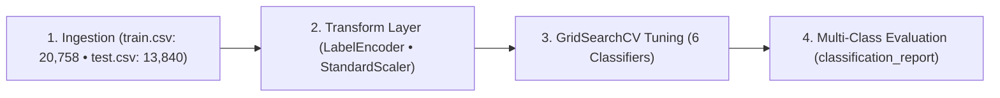

# Multi-Class Prediction of Obesity Risk (`Multi-Class-Prediction-of-Obesity-Risk`)

## Table of Contents
- [Executive Summary & Business Utility](#executive-summary--business-utility)
- [System Architecture & Layers](#system-architecture--layers)
- [Data Model & Feature Schema](#data-model--feature-schema)
- [Model Pipeline & Hyperparameter Tuning](#model-pipeline--hyperparameter-tuning)
- [Getting Started](#getting-started)
- [Business Value, ROI & Growth Opportunities](#business-value-roi--growth-opportunities)

---

## Executive Summary & Business Utility
`Multi-Class-Prediction-of-Obesity-Risk` is a 38-cell end-to-end machine learning pipeline (`multi-class-prediction-of-obesity-risk.ipynb`) processing **20,758 training records** (`train.csv`) and **13,840 test records** (`test.csv`). It benchmarks **6 classification algorithms** paired with **`GridSearchCV` hyperparameter optimization** to stratify individuals into multi-class obesity risk tiers (`NObeyesdad`) based on biometric and lifestyle habits.

---

## System Architecture & Layers


| Layer | Tools & Libraries |
| :--- | :--- |
| **Feature Transformation** | `pandas`, `numpy`, `LabelEncoder`, `StandardScaler` |
| **Tuning & Validation** | `train_test_split`, `GridSearchCV` |
| **Benchmarked Algorithms** | `LogisticRegression`, `RandomForestClassifier`, `GradientBoostingClassifier`, `GaussianNB`, `XGBClassifier`, `KNeighborsClassifier` |
| **Evaluation** | Multi-class Precision, Recall, and F1 via `classification_report` |

---

## Data Model & Feature Schema
- **Training Set**: `train.csv` (**20,758 rows**, 18 columns including target `NObeyesdad`)
- **Test Set**: `test.csv` (**13,840 rows**, 17 feature columns)
- **Features**: `id`, `Gender`, `Age`, `Height`, `Weight`, `family_history_with_overweight`, `FAVC` (high-caloric food), `FCVC` (vegetable frequency), `NCP` (main meals), `CAEC` (snacking), `SMOKE`, `CH2O` (water intake), `SCC` (calorie monitoring), `FAF` (physical activity), `TUE` (tech use), `CALC` (alcohol), `MTRANS` (transportation)

---

## Getting Started
```bash
git clone https://github.com/islamsamyy/Multi-Class-Prediction-of-Obesity-Risk.git
cd Multi-Class-Prediction-of-Obesity-Risk
jupyter notebook multi-class-prediction-of-obesity-risk.ipynb
```

---

## Business Value, ROI & Growth Opportunities
- **Digital Health & InsurTech Risk Stratification**: Enables wellness apps, corporate health programs, and insurers to segment metabolic risk early and trigger personalized coaching.
- **Production Inference API**: Export the `GridSearchCV`-tuned `XGBClassifier` / `GradientBoostingClassifier` via `joblib` behind a FastAPI microservice to power real-time mobile health screenings.
