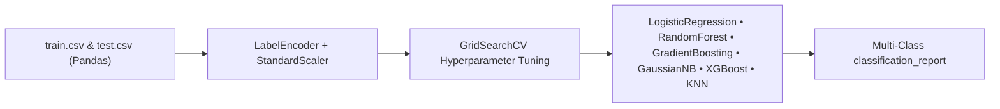

# Multi-Class Prediction of Obesity Risk (`Multi-Class-Prediction-of-Obesity-Risk`)

A comprehensive multi-class machine learning pipeline (`multi-class-prediction-of-obesity-risk.ipynb`, 38 cells) benchmarking **6 classifiers** with **`GridSearchCV` hyperparameter tuning** across `train.csv` and `test.csv` to classify individuals into obesity risk categories.

---

## 1. Executive Summary & Purpose
`Multi-Class-Prediction-of-Obesity-Risk` implements an end-to-end tabular ML workflow—including feature encoding, feature scaling, multi-model benchmarking, and grid-search optimization—to predict multi-level health risk tiers from lifestyle and biometric attributes.

## 2. Pipeline Architecture & Layers


| Layer | Tools & Methods |
| :--- | :--- |
| **Feature Engineering & Scaling** | `pandas`, `numpy`, `LabelEncoder`, `StandardScaler` |
| **Model Selection & Tuning** | `GridSearchCV`, `train_test_split` |
| **Benchmarked Algorithms** | `LogisticRegression`, `RandomForestClassifier`, `GradientBoostingClassifier`, `GaussianNB`, `XGBClassifier`, `KNeighborsClassifier` |
| **Evaluation** | Per-class Precision, Recall, and F1 via `classification_report` |

## 3. Getting Started
```bash
git clone https://github.com/islamsamyy/Multi-Class-Prediction-of-Obesity-Risk.git
cd Multi-Class-Prediction-of-Obesity-Risk
jupyter notebook multi-class-prediction-of-obesity-risk.ipynb
```

## 4. Business Value & Growth Opportunities
- **Preventive Health & InsurTech Underwriting**: Enables digital health apps, wellness platforms, and insurance providers to stratify metabolic risk early and recommend personalized coaching plans.
- **API & Mobile App Integration**: Export the top-tuned `XGBClassifier` / `GradientBoostingClassifier` artifact (`joblib`) behind a lightweight FastAPI service to power real-time consumer health assessments.
